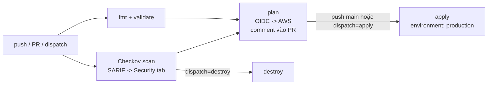
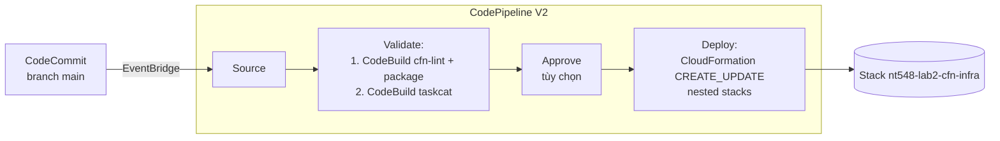
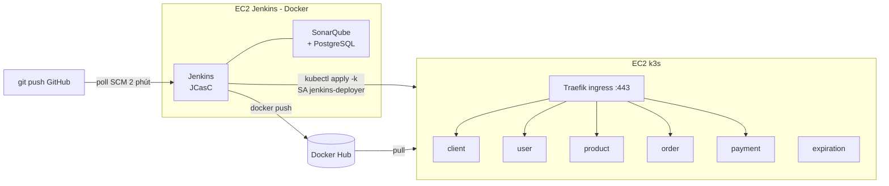

# NT548 – Bài tập thực hành 02

**Quản lý và triển khai hạ tầng AWS và ứng dụng microservices với Terraform, CloudFormation, GitHub Actions, AWS CodePipeline và Jenkins**

| Câu | Nội dung | Công cụ | Thư mục |
|---|---|---|---|
| 1 (3đ) | Hạ tầng Lab 1 bằng Terraform, CI/CD bằng GitHub Actions, quét bảo mật bằng Checkov | Terraform, GitHub Actions (OIDC), Checkov | [`cau1-terraform/`](cau1-terraform), [`.github/`](.github) |
| 2 (3đ) | Hạ tầng Lab 1 bằng CloudFormation (nested stacks), kiểm tra bằng cfn-lint + Taskcat, deploy bằng CodePipeline từ CodeCommit | CloudFormation, CodeCommit, CodeBuild, CodePipeline, cfn-lint, Taskcat | [`cau2-cloudformation/`](cau2-cloudformation) |
| 3 (4đ) | CI/CD ứng dụng microservices (6 service) trên Docker + Kubernetes, kiểm tra chất lượng mã bằng SonarQube, quét bảo mật bằng Trivy | Jenkins (JCasC), SonarQube, Trivy, Docker Hub, k3s, Kustomize | [`cau3-jenkins/`](cau3-jenkins) |

Hạ tầng "Lab 1" dùng chung cho Câu 1 và Câu 2:

```
                    Internet
                       │
                ┌──────┴──────┐
                │ Internet GW │
┌───────────────┴─────────────┴───────────────── VPC 10.0.0.0/16 ─┐
│  Public Subnet 10.0.1.0/24          Private Subnet 10.0.2.0/24  │
│  ┌──────────────────┐   SSH :22    ┌──────────────────┐         │
│  │ Public EC2       │ ───────────▶ │ Private EC2      │         │
│  │ (bastion)        │              │                  │         │
│  └──────────────────┘              └────────┬─────────┘         │
│  ┌──────────────────┐   0.0.0.0/0          │                    │
│  │ NAT Gateway (EIP)│ ◀────────────────────┘                    │
│  └──────────────────┘                                           │
│  Public RT: 0.0.0.0/0 → IGW          Private RT: 0.0.0.0/0 → NAT│
│  Public SG: SSH chỉ từ IP admin      Private SG: SSH chỉ từ Public SG
└─────────────────────────────────────────────────────────────────┘
```

---

## Mục lục

- [0. Chuẩn bị chung](#0-chuẩn-bị-chung)
- [1. Câu 1 – Terraform + GitHub Actions + Checkov](#1-câu-1--terraform--github-actions--checkov)
- [2. Câu 2 – CloudFormation + CodeBuild + CodePipeline](#2-câu-2--cloudformation--codebuild--codepipeline)
- [3. Câu 3 – Jenkins + SonarQube + Trivy + Kubernetes](#3-câu-3--jenkins--sonarqube--trivy--kubernetes)
- [4. Dọn dẹp tài nguyên](#4-dọn-dẹp-tài-nguyên)
- [5. Xử lý sự cố thường gặp](#5-xử-lý-sự-cố-thường-gặp)
- [6. Cấu trúc repo](#6-cấu-trúc-repo)

---

## 0. Chuẩn bị chung

### 0.1 Công cụ trên máy cá nhân

| Công cụ | Phiên bản | Kiểm tra |
|---|---|---|
| AWS CLI v2 | ≥ 2.15 | `aws --version` |
| Terraform | ≥ 1.10 (dùng S3 native locking) | `terraform version` |
| Git | bất kỳ | `git --version` |
| Python 3 + pip | ≥ 3.9 (chạy cfn-lint, taskcat, checkov local – tùy chọn) | `python3 --version` |
| (Tùy chọn) kubectl | ≥ 1.30 | `kubectl version --client` |
| (Tùy chọn) Session Manager plugin | – | `session-manager-plugin` |

### 0.2 Tài khoản

- AWS account, IAM user/role có quyền admin để chạy các bước bootstrap. Cấu hình: `aws configure` (Region mặc định: `ap-southeast-1`).
- GitHub account; repo này phải ở chế độ **public** (Câu 3, máy Jenkins clone repo không cần token).
- Docker Hub account + Personal Access Token (Read & Write) cho Câu 3.

### 0.3 Lấy IP public của bạn (dùng cho Security Group)

```bash
curl -s https://checkip.amazonaws.com    # ví dụ 113.161.10.20 -> dùng 113.161.10.20/32
```

### 0.4 Tạo SSH key (nếu chưa có)

```bash
ssh-keygen -t ed25519 -f ~/.ssh/nt548-lab2 -C "nt548-lab2"
cat ~/.ssh/nt548-lab2.pub      # nội dung public key dùng ở các bước sau
```

### 0.5 Đưa mã nguồn lên GitHub

Tạo repo **public** trống trên GitHub (ví dụ `NT548-Lab2`), rồi trong thư mục này:

```bash
git init -b main
git add .
git commit -m "NT548 Lab 2"
git remote add origin https://github.com/<owner>/NT548-Lab2.git
git push -u origin main
```

> **Chi phí:** NAT Gateway (~0.06 USD/giờ + data) ở Câu 1, Câu 2 (và stack tạm của Taskcat), EC2 `t3.xlarge` + `t3.large` ở Câu 3 (~0.25 USD/giờ). Hãy chạy [mục 4 – Dọn dẹp](#4-dọn-dẹp-tài-nguyên) ngay sau khi chụp ảnh kết quả.

---

## 1. Câu 1 – Terraform + GitHub Actions + Checkov

### 1.1 Thiết kế

```
cau1-terraform/
├── bootstrap/            # chạy 1 lần: S3 state bucket + GitHub OIDC provider + IAM role cho Actions
├── modules/
│   ├── vpc/              # VPC, 1..n public/private subnet, IGW, NAT GW + EIP, route tables,
│   │                     #   default SG bị khóa, VPC Flow Logs (CloudWatch + KMS)
│   ├── security-groups/  # Public SG (SSH từ allowed_ssh_cidr), Private SG (SSH từ Public SG)
│   └── ec2/              # EC2 hardening: IMDSv2, EBS mã hóa, detailed monitoring, IAM profile
├── main.tf variables.tf outputs.tf versions.tf
├── .checkov.yaml         # cấu hình Checkov
└── terraform.tfvars.example, backend.hcl.example
.github/
├── actions/terraform-setup/action.yml   # composite action: setup Terraform + OIDC + init
└── workflows/terraform.yml              # pipeline Câu 1
```

**Pipeline GitHub Actions** (`.github/workflows/terraform.yml`):



- **Pull Request** → Checkov + validate + plan, kết quả plan được comment vào PR.
- **Push vào `main`** → Checkov + validate + plan → **apply đúng file plan đã tạo** (artifact `tfplan`).
- **Run workflow (thủ công)** → chọn `plan` / `apply` / `destroy`.
- Checkov có lỗi (`soft_fail: false`) → pipeline dừng, không apply. Các ngoại lệ được skip ngay trong code bằng `#checkov:skip=<ID>:<lý do>` để dễ review.
- Xác thực AWS bằng **OIDC** (không lưu Access Key trong GitHub). State lưu S3, khóa bằng `use_lockfile`.

### 1.2 Bước 1 – Bootstrap (chạy 1 lần trên máy cá nhân)

```bash
cd cau1-terraform/bootstrap
terraform init
terraform apply \
  -var="github_repo=<github-owner>/<ten-repo>" \
  -var="aws_region=ap-southeast-1"
# Nếu account đã có GitHub OIDC provider: thêm -var="create_github_oidc_provider=false"
terraform output
```

Output cần ghi lại: `state_bucket`, `github_actions_role_arn`, `aws_region`.

### 1.3 Bước 2 – Cấu hình GitHub repo

**Settings → Secrets and variables → Actions → tab Variables → New repository variable:**

| Variable | Giá trị |
|---|---|
| `AWS_REGION` | `ap-southeast-1` |
| `AWS_ROLE_ARN` | output `github_actions_role_arn` |
| `TF_STATE_BUCKET` | output `state_bucket` |
| `ALLOWED_SSH_CIDR` | IP của bạn, ví dụ `113.161.10.20/32` |
| `SSH_PUBLIC_KEY` | nội dung `~/.ssh/nt548-lab2.pub` |

**Settings → Environments → New environment `production`** (tùy chọn: bật *Required reviewers* để phải bấm duyệt trước khi apply).

### 1.4 Bước 3 – Chạy pipeline

```bash
git checkout -b feature/cau1
# sửa nhẹ 1 file trong cau1-terraform/ (vd thêm tag) rồi:
git commit -am "Cau 1: test pipeline" && git push -u origin feature/cau1
```

1. Tạo Pull Request vào `main` → xem tab **Checks**: `Checkov security scan`, `Terraform fmt & validate`, `Terraform plan` và comment plan trong PR.
2. Merge PR → workflow chạy trên `main` → job **Terraform apply** (nếu bật reviewer thì bấm *Review deployments → Approve*).
3. Hoặc vào **Actions → Cau 1 - Terraform CI/CD → Run workflow → action = apply**.

### 1.5 Chạy local (tùy chọn – để debug)

```bash
cd cau1-terraform
cp terraform.tfvars.example terraform.tfvars    # sửa allowed_ssh_cidr, ssh_public_key
cp backend.hcl.example backend.hcl              # sửa bucket = output state_bucket
terraform init -backend-config=backend.hcl
terraform plan
pip install checkov && checkov --config-file .checkov.yaml -d .
```

### 1.6 Kiểm tra kết quả

- **GitHub:** tab *Actions* (các job xanh), *Summary* của job apply có `terraform output`; tab *Security → Code scanning* có kết quả Checkov (repo public); artifact `checkov-report`.
- **AWS Console** (Region `ap-southeast-1`): VPC `nt548-lab2-dev-vpc`, Subnets, Route tables (public → igw, private → nat), NAT Gateway, 2 EC2, 2 Security Group, CloudWatch log group `/vpc/nt548-lab2-dev/flow-logs`.
- **Kiểm tra kết nối** (IP lấy từ output):

```bash
ssh -i ~/.ssh/nt548-lab2 ec2-user@<public_ec2_public_ip>                       # vào Public EC2
ssh -i ~/.ssh/nt548-lab2 -J ec2-user@<public_ec2_public_ip> ec2-user@<private_ec2_private_ip>
# trong Private EC2:
curl -s https://checkip.amazonaws.com    # phải trả về nat_public_ip  => đi ra Internet qua NAT
```

---

## 2. Câu 2 – CloudFormation + CodeBuild + CodePipeline

### 2.1 Thiết kế

```
cau2-cloudformation/
├── templates/
│   ├── main.yaml             # root stack: gọi 3 nested stack bên dưới
│   ├── vpc.yaml              # VPC, subnets, IGW, NAT GW, route tables
│   ├── security-groups.yaml  # Public SG / Private SG (+ Rule chặn 0.0.0.0/0)
│   └── ec2.yaml              # Launch Template (IMDSv2, EBS mã hóa) + 2 EC2 + IAM role SSM
├── pipeline/pipeline.yaml    # CodeCommit repo + S3 artifact + 2 CodeBuild + CodePipeline + EventBridge
├── buildspecs/
│   ├── lint-package.yml      # cfn-lint + validate-template + upload templates lên S3 theo commit
│   └── taskcat.yml           # taskcat lint + taskcat test run (deploy thật -> xóa)
├── config/prod.json          # tham số stack hạ tầng (sửa AllowedSSHCidr, KeyName)
├── .taskcat.yml              # cấu hình Taskcat
└── .cfnlintrc.yaml           # cấu hình cfn-lint
```



- Nested templates được upload lên `s3://<artifact-bucket>/releases/<commit-id>/templates/`, root stack nhận `TemplatesBucketName`/`TemplatesKeyPrefix` → mỗi commit là một bản phát hành bất biến.
- cfn-lint chỉ làm fail build khi có **error** (warning vẫn hiển thị). Kết quả JUnit hiển thị ở **CodeBuild → Report groups**.
- Taskcat tự tạo bucket `tcat-…`, deploy thử toàn bộ hạ tầng ở `ap-southeast-1`, kiểm tra `CREATE_COMPLETE` rồi xóa; báo cáo HTML nằm trong artifact `TaskcatReport`.

### 2.2 Bước 1 – (Tùy chọn) kiểm tra local

```bash
cd cau2-cloudformation
pip install "cfn-lint>=1.20" taskcat
cfn-lint                       # đọc .cfnlintrc.yaml
taskcat lint
# taskcat test run             # deploy thật ~10-15 phút, tốn phí NAT
```

### 2.3 Bước 2 – Sửa tham số

Sửa `cau2-cloudformation/config/prod.json`:

- `AllowedSSHCidr`: IP của bạn `/32`.
- `KeyName`: tên Key Pair có sẵn trên EC2 (Console → EC2 → Key Pairs → *Import key pair* với `~/.ssh/nt548-lab2.pub`), hoặc để `""` và dùng Session Manager.

Commit thay đổi vào repo GitHub như bình thường.

### 2.4 Bước 3 – Tạo pipeline

```bash
aws cloudformation deploy \
  --stack-name nt548-lab2-pipeline \
  --template-file cau2-cloudformation/pipeline/pipeline.yaml \
  --capabilities CAPABILITY_IAM \
  --region ap-southeast-1 \
  --parameter-overrides RepositoryName=nt548-lab2 BranchName=main \
                        EnableTaskcat=true EnableManualApproval=false

aws cloudformation describe-stacks --stack-name nt548-lab2-pipeline \
  --query "Stacks[0].Outputs" --output table --region ap-southeast-1
```

> Tên stack pipeline phải viết thường (dùng làm tên S3 bucket). Đặt `EnableTaskcat=false` nếu muốn pipeline nhanh hơn/tiết kiệm phí.

### 2.5 Bước 4 – Đẩy mã nguồn lên CodeCommit

Cách khuyến nghị: dùng `git-remote-codecommit` với chính AWS credentials đang dùng:

```bash
pip install git-remote-codecommit
git remote add codecommit codecommit::ap-southeast-1://nt548-lab2
git push codecommit main
```

> Cách khác: IAM → Users → *Security credentials* → *HTTPS Git credentials for AWS CodeCommit* → dùng URL `RepositoryCloneUrlHttp` trong output.

Mỗi lần `git push codecommit main`, EventBridge tự kích hoạt pipeline.

### 2.6 Kiểm tra kết quả

- **CodePipeline** → pipeline `nt548-lab2-pipeline`: Source ✔ → Validate (`cfn-lint-and-package`, `taskcat-test`) ✔ → Deploy ✔.
- **CodeBuild** → build log của `…-cfn-lint` (kết quả cfn-lint, `validate-template`), *Report groups* `…-cfn-lint-cfn-lint` (JUnit); log của `…-taskcat` có dòng `CREATE_COMPLETE` và tóm tắt PASS.
- **S3** → artifact bucket: `releases/<commit>/templates/*.yaml`; artifact `TaskcatReport` (tải về, mở `index.html`).
- **CloudFormation** → stack `nt548-lab2-cfn-infra` + 3 nested stack (`…-VpcStack-…`, `…-SecurityGroupStack-…`, `…-Ec2Stack-…`), tab *Outputs* có IP và lệnh SSH.
- **Kiểm tra kết nối** giống [mục 1.6](#16-kiểm-tra-kết-quả) với IP trong *Outputs* (`SshToPublic`, `SshToPrivateViaBastion`).
- **Thử lỗi:** sửa `templates/vpc.yaml` sai kiểu (vd `EnableDnsSupport: abc`) → push → stage *Validate* fail ở cfn-lint, stack hạ tầng không bị đụng tới.

---

## 3. Câu 3 – Jenkins + SonarQube + Trivy + Kubernetes

### 3.1 Ứng dụng

[Aurapan](https://github.com/tuan-devops/microservices-ecommerce) (giảng viên gợi ý) – web bán quần áo theo kiến trúc microservices, mã nguồn đặt tại `cau3-jenkins/app/`:

| Service | Công nghệ | Ghi chú |
|---|---|---|
| `client` | Next.js 12 (SSR) | giao diện |
| `user`, `product`, `order`, `payment` | Node.js + TypeScript + Express + MongoDB | có unit test Jest |
| `expiration` | Node.js + Bull (Redis) | hết hạn đơn hàng |
| hạ tầng | MongoDB ×4, NATS Streaming, Redis | event-driven giữa các service |

Thay đổi so với upstream: Dockerfile ghim base image và chạy user non-root; `client/api/build-client.js` đọc `SERVER_BASE_URL` để SSR gọi API nội bộ cluster (Traefik); manifest Kubernetes viết lại cho k3s (`cau3-jenkins/k8s/base`).

### 3.2 Kiến trúc CI/CD



Các stage của `cau3-jenkins/Jenkinsfile`:

| # | Stage | Mô tả |
|---|---|---|
| 1 | Checkout | lấy mã, tag image = `<build>-<sha7>` |
| 2 | Detect changes | `git diff` với commit thành công trước → chỉ build service thay đổi (`BUILD_ALL` để build hết) |
| 3 | Unit test | 4 service chạy Jest **song song** trong container `node:20`, xuất JUnit + coverage lcov |
| 4 | SonarQube analysis | `sonar-scanner` phân tích cả 6 service + coverage |
| 5 | Quality Gate | chờ webhook SonarQube; không đạt → dừng (tham số `QUALITY_GATE_BLOCKING`) |
| 6 | Trivy – source scan | lỗ hổng thư viện, secret, misconfig (Dockerfile, k8s, Terraform) |
| 7 | Build images | `docker build` **song song** các service thay đổi |
| 8 | Trivy – image scan | báo cáo JSON/TXT/HTML; có CRITICAL đã có bản vá → UNSTABLE (hoặc FAIL nếu `TRIVY_BLOCK_ON_CRITICAL`) |
| 9 | Push images | Docker Hub (`<user>/aurapan-<svc>:<tag>` + `latest`) |
| 10 | Deploy to k3s | `scripts/deploy.sh`: tạo Secret, sinh overlay Kustomize (service không đổi giữ nguyên tag), `kubectl apply -k`, chờ rollout |
| 11 | Smoke test | gọi `/api/users/currentuser`, `/api/products`, `/` qua ingress |

Bảo mật: Jenkins cấu hình hoàn toàn bằng code (JCasC), credentials lấy từ `.env` trên máy chủ (không nằm trong Git); Jenkins deploy bằng ServiceAccount chỉ có quyền `admin` trong namespace `aurapan`; kubeconfig chuyển qua S3 mã hóa bằng IAM role; Docker login dùng `DOCKER_CONFIG` tạm.

### 3.3 Bước 1 – Đẩy repo lên GitHub (public)

Máy Jenkins sẽ clone repo này lúc khởi động nên phải push trước (xem [mục 0.5](#05-đưa-mã-nguồn-lên-github)). Kiểm tra repo đang ở chế độ **public**.

### 3.4 Bước 2 – Tạo hạ tầng (EC2 Jenkins + EC2 k3s) bằng Terraform

```bash
cd cau3-jenkins/infra
cp terraform.tfvars.example terraform.tfvars
# sửa: admin_cidr, lab_repo_url (https://github.com/<owner>/<ten-repo>.git), ssh_public_key
terraform init
terraform apply
terraform output
```

Đợi ~5–8 phút cho user-data chạy xong (cài k3s, Docker, kéo image, tải kubeconfig). Kiểm tra:

```bash
ssh -i ~/.ssh/nt548-lab2 ubuntu@<jenkins_public_ip>
sudo tail -f /var/log/user-data.log          # đợi dòng "Jenkins host READY"
ls -l /opt/lab2/cau3-jenkins/jenkins/secrets/kubeconfig
```

### 3.5 Bước 3 – Khởi tạo Jenkins + SonarQube

Trên máy Jenkins:

```bash
cd /opt/lab2/cau3-jenkins/jenkins
nano .env
#   DOCKERHUB_USER=<docker hub username>
#   DOCKERHUB_TOKEN=<docker hub access token>
#   JENKINS_ADMIN_PASSWORD=<mật khẩu Jenkins>
#   SONAR_ADMIN_PASSWORD=<>=12 ký tự, có Hoa, thường, số, ký tự đặc biệt>
#   POSTGRES_PASSWORD=<mật khẩu DB của SonarQube>
./bootstrap.sh
```

`bootstrap.sh` sẽ: bật SonarQube + PostgreSQL → đổi mật khẩu `admin` mặc định → sinh token cho Jenkins → tạo webhook `http://jenkins:8080/sonarqube-webhook/` → sinh `JWT_KEY` → build image Jenkins (cài plugin, docker CLI, kubectl) và khởi động. JCasC tự tạo: user admin, 4 credentials (`dockerhub`, `sonarqube-token`, `k3s-kubeconfig`, `app-jwt-key`), cấu hình SonarQube server và job `aurapan-microservices`.

### 3.6 Bước 4 – Chạy pipeline

1. Mở `http://<jenkins_public_ip>:8080` → đăng nhập.
2. Job **aurapan-microservices** → **Build with Parameters** → tích `BUILD_ALL` (lần đầu) → **Build**. Lần chạy đầu ~20–30 phút (npm install, build Next.js, tải Trivy DB).
3. Các lần sau: chỉ cần `git push` lên GitHub, Jenkins poll mỗi 2 phút và **chỉ build lại service có thay đổi**.

### 3.7 Kiểm tra kết quả

| Ở đâu | Xem gì |
|---|---|
| Jenkins → job → *Stage View* / *Pipeline Overview* | tất cả stage xanh, thời gian từng stage, nhánh song song |
| Jenkins → build → *Test Result* | kết quả Jest của 4 service |
| Jenkins → build → *Security reports* / *Artifacts* | `trivy-fs.txt`, `trivy-image-*.html/.txt/.json`, `rendered.yaml` |
| `http://<jenkins_public_ip>:9000` → project `nt548-lab2-aurapan` | Bugs, Vulnerabilities, Code Smells, Coverage, Duplications, Quality Gate |
| Docker Hub | repo `aurapan-client`, `aurapan-user`, … với tag `<build>-<sha>` |
| Trình duyệt `https://<k3s_public_ip>/` | trang Aurapan (chấp nhận cảnh báo chứng chỉ self-signed). Thử đăng ký tài khoản |

Kiểm tra cluster:

```bash
ssh -i ~/.ssh/nt548-lab2 ubuntu@<k3s_public_ip>
kubectl -n aurapan get pods,svc,ingress -o wide
kubectl -n aurapan get deploy -o custom-columns=NAME:.metadata.name,IMAGE:.spec.template.spec.containers[0].image
kubectl -n aurapan logs deploy/user-depl --tail=20
curl -sk https://localhost/api/users/currentuser      # {"currentUser":null}
```

Hoặc dùng kubectl từ máy cá nhân: `scp ubuntu@<k3s_public_ip>:~/.kube/config-public ~/.kube/k3s-lab2` rồi `KUBECONFIG=~/.kube/k3s-lab2 kubectl get nodes` (port 6443 đã mở cho `admin_cidr`).

**Kịch bản demo CI/CD:**

```bash
# 1. Sửa 1 dòng trong service user rồi push -> chỉ user được build/deploy lại
echo "// demo $(date)" >> cau3-jenkins/app/user/src/app.ts
git commit -am "demo: thay doi service user" && git push
# 2. Theo dõi rollout trên k3s
kubectl -n aurapan rollout history deploy/user-depl
```

---

## 4. Dọn dẹp tài nguyên

```bash
# Câu 3
cd cau3-jenkins/infra && terraform destroy

# Câu 2: xóa stack hạ tầng trước, sau đó stack pipeline
aws cloudformation delete-stack --stack-name nt548-lab2-cfn-infra --region ap-southeast-1
aws cloudformation wait stack-delete-complete --stack-name nt548-lab2-cfn-infra --region ap-southeast-1
BUCKET=$(aws cloudformation describe-stacks --stack-name nt548-lab2-pipeline --region ap-southeast-1 \
  --query "Stacks[0].Outputs[?OutputKey=='ArtifactBucketName'].OutputValue" --output text)
aws s3api delete-objects --bucket "$BUCKET" --region ap-southeast-1 --delete "$(aws s3api list-object-versions \
  --bucket "$BUCKET" --region ap-southeast-1 --output json \
  --query '{Objects: [Versions[].{Key:Key,VersionId:VersionId}, DeleteMarkers[].{Key:Key,VersionId:VersionId}][]}')"
aws cloudformation delete-stack --stack-name nt548-lab2-pipeline --region ap-southeast-1
# Repo CodeCommit được giữ lại (DeletionPolicy: Retain):
aws codecommit delete-repository --repository-name nt548-lab2 --region ap-southeast-1
# Bucket tạm của taskcat (nếu còn): aws s3 ls | grep tcat-

# Câu 1: GitHub -> Actions -> Run workflow -> action = destroy
# rồi (khi không cần nữa) xóa bootstrap:
cd cau1-terraform/bootstrap && terraform destroy -var="github_repo=<owner>/<repo>" -var="force_destroy_state_bucket=true"
```

> Nếu lệnh `delete-objects` báo lỗi vì bucket đã rỗng thì bỏ qua và chạy tiếp lệnh `delete-stack`.

---

## 5. Xử lý sự cố thường gặp

| Hiện tượng | Nguyên nhân / cách xử lý |
|---|---|
| Actions: `Not authorized to perform sts:AssumeRoleWithWebIdentity` | `github_repo` ở bootstrap sai chữ hoa/thường hoặc thiếu `permissions: id-token: write`; kiểm tra lại variable `AWS_ROLE_ARN` |
| Actions: `EntityAlreadyExists ... OpenIDConnect provider` khi bootstrap | account đã có provider → `-var="create_github_oidc_provider=false"` |
| Checkov fail | đọc log job Checkov: sửa code, hoặc (nếu có lý do chính đáng) thêm `#checkov:skip=ID:lý do` |
| CodePipeline Source fail `codecommit` | chưa push branch `main` lên CodeCommit hoặc sai `RepositoryName` |
| Taskcat fail `CREATE_FAILED` | xem tab *Events* của stack `tCaT-…` trong CloudFormation (thường do quota EIP/NAT hoặc AZ không hỗ trợ `t3.micro`) |
| Deploy stage CloudFormation `ROLLBACK_COMPLETE` | xóa stack `nt548-lab2-cfn-infra` rồi chạy lại pipeline (*Release change*) |
| Jenkins không lên / `bootstrap.sh` báo thiếu kubeconfig | `sudo tail -100 /var/log/user-data.log` trên cả 2 máy; trên k3s: `sudo cat /var/log/user-data.log \| tail` |
| SonarQube container tự tắt | thiếu `vm.max_map_count` (user-data đã set) hoặc thiếu RAM – dùng `t3.xlarge` |
| Quality Gate `IN_PROGRESS` mãi | webhook chưa tạo: SonarQube → Administration → Configuration → Webhooks phải có `http://jenkins:8080/sonarqube-webhook/` |
| Quality Gate `ERROR` | xem chi tiết trong SonarQube; muốn demo tiếp có thể bỏ tích `QUALITY_GATE_BLOCKING` |
| Unit test lỗi tải MongoDB | `mongodb-memory-server` cần Internet để tải binary MongoDB lần đầu – kiểm tra outbound của máy Jenkins |
| Pod `CrashLoopBackOff`/`OOMKilled` | `kubectl -n aurapan describe pod <pod>`; tăng `limits.memory` trong `k8s/base/<svc>.yaml` |
| Đăng ký tài khoản không giữ được đăng nhập | phải truy cập bằng **https://** (cookie `secure`) |

---

## 6. Cấu trúc repo

```
.
├── .github/
│   ├── actions/terraform-setup/action.yml
│   └── workflows/terraform.yml
├── cau1-terraform/          # Câu 1
├── cau2-cloudformation/     # Câu 2
└── cau3-jenkins/            # Câu 3
    ├── Jenkinsfile
    ├── sonar-project.properties
    ├── app/                 # mã nguồn 6 microservice (Aurapan, giấy phép gốc: app/LICENSE-upstream)
    ├── infra/               # Terraform: VPC, EC2 Jenkins, EC2 k3s, S3, IAM + user-data
    ├── jenkins/             # Dockerfile, plugins.txt, casc.yaml, docker-compose.yml, bootstrap.sh
    ├── k8s/base/            # manifest Kubernetes + kustomization
    └── scripts/             # detect-changes.sh, deploy.sh, smoke-test.sh
```

### Tài liệu tham khảo

- Terraform AWS Provider, GitHub Actions docs (composite actions, OIDC), Checkov docs.
- AWS CloudFormation User Guide (nested stacks), AWS CodePipeline/CodeBuild docs, cfn-lint, Taskcat.
- Jenkins Pipeline & Configuration as Code, SonarQube Scanner for Jenkins, Trivy docs, k3s docs.
- Các repo tham khảo do giảng viên cung cấp (tuan-devops/*).
